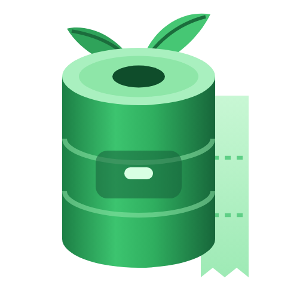

<p align="center"></p>

# Toilet Bamboo Paper GeekMcON

> Antes **Çekmecón**. Solo cambió el nombre visible: el comando `cekmecon` (ahora también `geekmcon`), las herramientas MCP `cekmecon_*`, la carpeta `~/Cekmecon` y tus permisos siguen igual.

**La app de escritorio que le da memoria a Claude.** Un cajón (*çekmece* en turco) de notas Markdown que Claude ordena solo, para que nunca tenga que releer todo desde cero.

Sitio: https://lukoffmon.github.io/HighPerformanceClaude/cekmecon/ · **Versión web (sin instalar, funciona offline):** https://lukoffmon.github.io/HighPerformanceClaude/cekmecon/app/

## Descargar (recomendado)

| Sistema | Descarga |
|---|---|
| Windows 10/11 | [Cekmecon-Setup-Windows.exe](https://github.com/LukOffMon/HighPerformanceClaude/releases/latest/download/Cekmecon-Setup-Windows.exe) — instalador, sin admin. Si sale “Windows protegió tu PC”: *Más información → Ejecutar de todas formas* |
| macOS (Apple Silicon) | [Cekmecon-macOS.dmg](https://github.com/LukOffMon/HighPerformanceClaude/releases/latest/download/Cekmecon-macOS.dmg) — arrastra GeekMcON a Aplicaciones. La primera vez: *Ajustes → Privacidad y seguridad → Abrir igualmente* |
| Linux x86_64 | [Cekmecon-Linux-x86_64.tar.gz](https://github.com/LukOffMon/HighPerformanceClaude/releases/latest/download/Cekmecon-Linux-x86_64.tar.gz) — descomprime y ejecuta `./install-linux.sh` |

Programa autónomo: no necesita Python. Al abrirlo por primera vez se registra solo en Claude Code. Los binarios los compila `.github/workflows/cekmecon-release.yml` (PyInstaller + Inno Setup) y se publican en GitHub Releases en cada push a `main`.

## Instalar desde el código (alternativa)

| Sistema | Comando |
|---|---|
| Windows (PowerShell) | `irm https://raw.githubusercontent.com/LukOffMon/HighPerformanceClaude/main/apps/cekmecon/install.ps1 \| iex` |
| macOS / Linux | `curl -fsSL https://raw.githubusercontent.com/LukOffMon/HighPerformanceClaude/main/apps/cekmecon/install.sh \| bash` |
| Cualquiera (pip) | `pip install "https://github.com/LukOffMon/HighPerformanceClaude/archive/refs/heads/main.zip#subdirectory=apps/cekmecon"` y luego `cekmecon connect` |

El instalador es para tu usuario (sin admin): pone la app en el menú de inicio o en Aplicaciones, la conecta a Claude Code (`cekmecon connect`) y la abre. Solo necesita Python 3.9 o superior (en Windows lo instala con winget si falta). Desinstalar: `install.sh --uninstall` o `cekmecon disconnect` + `pip uninstall cekmecon`.

## Conectar con Claude (una sola vez)

1. Abre Claude Code en tu proyecto, en esta computadora, y pídele algo.
2. Claude Code pregunta si puede usar las herramientas `cekmecon`: elige **Yes, and don't ask again**.
3. En la ventana de GeekMcON, Rollito avisa que Claude quiere entrar: pulsa **Permitir siempre**.

Desde entonces cada sesión en esa PC entra sola. Si la app está cerrada, el puente MCP la abre. Las sesiones en la nube no intentan conectarse. Revocar: botón **Claude** en la app, o `cekmecon disconnect`.

## Qué hace

- **Un cajón por proyecto**, creado solo la primera vez que Claude trabaja ahí: `README.md` (brief), `Map.md` (stack, comandos y estructura, regenerado cada vez), `Decisions.md`, `Lessons.md`, `Tasks.md`, `Log.md`.
- **Paquetes de memoria con tope de tokens**: perfil + brief + mapa + tareas abiertas + decisiones recientes + lecciones + notas que coinciden con la tarea, en ~1.500 tokens.
- **Búsqueda con ranking** (SQLite FTS5 / BM25, sin acentos), enlaces `[[wiki]]`, #etiquetas y enlaces entrantes.
- **Neuronas** (`Alt+G`): tu memoria como red viva de partículas. Nueve formas que se transforman entre sí (cerebro 3D, neurona con dendritas y un axón de tareas abiertas, red de fuerzas, galaxia, clústeres, matriz de espacios, rueda temporal, calendario día a día, corriente), sinapsis que se encienden por los enlaces, color por proyecto/carpeta/tipo/edad, buscar y resaltar, aislar un espacio, clic para abrir la nota.
- **Captura rápida** (`Alt+C`), siempre abajo: escribe o dicta (🎙) y se guarda con la hora en la nota de hoy.
- **Pendientes**: todos los `- [ ]` del cajón en una lista; se marcan sin abrir la nota.
- **Repasar** lo de hace una semana, un mes y un año, o una nota al azar (`Alt+R`). **Leer en voz alta** (🔊).
- **Comandos**: `Ctrl+K` y escribe `>`; `?` muestra todos los atajos.
- **Nota del día** (`Alt+D`): `Inbox/Diario/AAAA-MM-DD.md` con notas y tareas; nunca sobrescribe un día existente.
- **Inicio** con vista previa de Neuronas y notas recientes; tema claro/oscuro/automático; ventana adaptada al móvil.
- **Organizar**: reparte el Inbox al cajón correcto, enlaza notas relacionadas que escribió Claude y quita lecciones duplicadas. Nunca reescribe tus notas a mano; nunca borra (archiva).
- **Rollito**, el asistente pixel art que siempre está en pantalla y narra lo que Claude hace: trabaja, lee, escribe, piensa, celebra, alerta y duerme.
- Compatible con **Obsidian**: `cekmecon --vault "ruta/a/tu/boveda"`. Los cambios hechos fuera se reindexan solos.

### Versión web

La misma ventana corre en el navegador (`docs/cekmecon/app/`, publicada en GitHub Pages) sobre `ui/webstore.js`, que implementa la API local dentro del navegador: notas en IndexedDB, búsqueda, enlaces, Neuronas, nota del día, **importar** una carpeta de `.md` y **exportar** todo en un `.zip`. Es una PWA: tras la primera visita funciona sin conexión y se puede instalar. No habla con la app de escritorio (que rechaza otros orígenes a propósito); para conectar Claude usa la app de escritorio.

### Herramientas MCP

| Herramienta | Para qué |
|---|---|
| `cekmecon_open_project` | Al empezar: crea/refresca el cajón y devuelve la memoria |
| `cekmecon_context` | Memoria para una tarea, con presupuesto de tokens |
| `cekmecon_search` | Búsqueda con ranking y fragmentos |
| `cekmecon_read` | Leer una nota (o un rango de líneas) |
| `cekmecon_remember` | Guardar decisión, lección, tarea, registro o nota |
| `cekmecon_write_note` | Crear o reemplazar una nota larga |
| `cekmecon_organize` | Ordenar el Inbox, enlazar, quitar duplicados |
| `cekmecon_status` | Estado de la conexión y proyectos |

## Seguridad

- Escucha solo en `127.0.0.1`; rechaza cabeceras `Host` ajenas (DNS rebinding), peticiones con `Origin` de otros sitios y POST que no sean JSON.
- La ventana usa una clave por proceso incrustada en la página; Claude usa un token que solo se emite cuando pulsas Permitir. “Siempre” guarda el hash del token en `~/.cekmecon/clients.json`; “Solo esta sesión” lo guarda en memoria.
- Solo escribe archivos `.md` dentro de la bóveda; rutas con `..` o carpetas internas se rechazan.
- Única salida a internet: si hay conexión, la ventana consulta una vez al día la última versión publicada en GitHub (sin enviar datos tuyos).

## Comandos

```
cekmecon                abrir la app
cekmecon --vault RUTA   usar otra carpeta como bóveda (p. ej. tu bóveda de Obsidian)
cekmecon connect        registrar en Claude Code + instalar la skill
cekmecon disconnect     quitar de Claude Code y olvidar el token
cekmecon status         estado, bóveda y conexiones permitidas
```

## Desarrollo

Solo biblioteca estándar de Python. Pruebas de punta a punta (bóveda, organizador, app HTTP, emparejamiento y puente MCP):

```bash
python3 -m unittest discover -s apps/cekmecon/tests
PYTHONPATH=apps/cekmecon python3 -m cekmecon      # ejecutar desde el código
```

Compilar el programa para tu sistema: `pip install pyinstaller && python3 apps/cekmecon/packaging/build.py` (en Windows también Inno Setup 6).

`cekmecon/ui/` es la ventana (HTML/CSS/JS sin build): `app.js` (ventana), `neurons.js` (Neuronas, también usada por el sitio), `webstore.js` (backend en el navegador para la versión web), `mascot.js` (Rollito). `python3 tools/build_site.py` publica la versión web en `docs/cekmecon/app/`. `cekmecon/skill/SKILL.md` es una copia de `skills/cekmecon/SKILL.md` (el validador comprueba que sean iguales).
